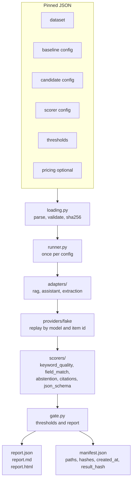

# llm-release-gate

<p align="center"></p>

**Stop unsafe prompt, model, retrieval, tool, or configuration changes from being merged.**

[](https://github.com/Chris0Jeky/llm-release-gate/actions/workflows/ci.yml)
[](pyproject.toml)
[](LICENSE)

## What it is

llm-release-gate is a CLI and a composite GitHub Action. You give it a versioned golden dataset, the configuration that is live today, the configuration under review, the scorers that judge outputs, and the thresholds that define a material regression. Optional pricing turns reported token counts into a cost.

It runs both configurations over the same items, scores them, and writes `report.json`, `report.md`, `report.html`, and `manifest.json`. Exit codes are part of the interface: **0** pass, **1** regression blocked, **2** the gate could not run. Misconfiguration is never a silent pass.

The default provider is `fake`. It replays committed fixtures, so the demos, the tests, and CI need no API key and no network call to a model.

Published source is [v0.2.0](https://github.com/Chris0Jeky/llm-release-gate/releases/tag/v0.2.0), GPL-3.0-only. This checkout is unreleased `main` past that tag. Commands that exist only here are marked below.

## Why it exists

A prompt edit, a model swap, a retrieval change, or a tool-config tweak can wreck answer quality and still look harmless in a diff. The gate makes that change measurable at review time, against thresholds you wrote, with the sample counts sitting next to every rate.

The deliberate red demo is the product in one run. The candidate swaps fictional `demo-pro-1` for `demo-mini-1`. On this checkout, Python 3.12.3, cost falls from $0.101448 to $0.0036864 (96.4%). The gate still fails: quality 8/8 to 5/8, false answers 0/2 to 2/2, citation validity 8/8 to 7/10.

The extraction example is the mirror image. A cheaper model keeps 6/6 field matches and 6/6 schema-valid outputs, cuts cost 95.5%, and passes.

## Features

Shipped in v0.2.0 and still the core:

- Baseline versus candidate over one dataset, one comparison, one verdict.
- Task adapters: `rag`, `assistant`, `extraction`.
- Scorers: `keyword_quality` (heuristic), `field_match` (exact JSON fields), `abstention`, `citations`, `json_schema`. Each metric has one owner.
- Thresholds: absolute and percent drop or increase against the baseline, plus min/max on the candidate, at level `fail` or `warn`.
- Latency percentiles, token totals, and cost from a versioned pricing table. Missing usage or a missing price stays unavailable, with a reason.
- Fail closed. An unevaluable rule fails unless you set `on_unavailable` to `warn` or `skip`. If you do not gate `errors.error_rate`, an implicit `max_value: 0` rule is added for the candidate.
- `report.json` has no timestamps and no filesystem paths. `result_hash` is the sha256 of its canonical JSON. `manifest.json` holds paths, input hashes, tool version, and `created_at`.
- Composite Action: install, run, job summary, PR comment, then enforce the verdict. Comment delivery failure is a warning. The verdict decides the check.
- Zero runtime dependencies. The only declared dev dependency is pytest.

On this checkout, after v0.2.0, and not in the `v0` / `v0.2.0` tags:

- `plan` fingerprints rendered requests and does not call a provider.
- Opt-in `provider_options.request_binding: "sha256-v1"` checks each fixture against the rendered request. `gate --require-request-binding` requires it on both sides. A hash match is content consistency. It is not proof that a model ran, and it is not producer authenticity.
- `--max-input-bytes` caps each JSON input, including referenced fixtures. Omit it and the legacy unlimited read remains. A breach exits 2.
- `run --fail-on-errors` still writes `run.json`, then exits 2 if any item failed. Plain `run` stays a diagnostic command and exits 0.
- Staged publication of outputs, with alias checks, a lock, and rollback. See [output safety](docs/output-safety.md).
- `verify` checks a completed bundle offline. Optional `--expected-result-hash` and `--expected-bundle-hash` pins detect a full rewrite. An intact failed gate is not a pass; `--require-pass` returns exit 1 for that recorded failure.
- `audit` applies a consumer threshold file to verified stored aggregates. The original gate verdict and the new policy verdict stay separate. It does not rerun models or scorers.
- `field_match` version 3 treats a missing field as missing. The literal string `<missing>` is no longer a stand-in for absence.
- GitHub Actions output values that contain newlines are written as literal command-file payloads. See [command-file safety](docs/github-command-safety.md).

## Architecture



`runner` does the loop twice: adapter renders the prompt, the provider returns text (or a recorded error), the adapter parses it, scorers score applicable items. `pricing.py` multiplies reported tokens by the table. Registries are plain dicts filled at import. Extension points and the schemas are in [docs/architecture.md](docs/architecture.md) and [docs/extending.md](docs/extending.md).

`plan` stops before the provider. `verify` and `audit` read the four artifacts and do not walk stored paths back to source inputs.

## Quickstart

No API key. From a checkout, with Python 3.11 or newer:

```bash
make install      # pip install -e ".[dev]"
make test         # pytest
make demo-green   # rag prompt change and safe extraction swap; both exit 0
make demo-red     # cheap assistant regression; succeeds only when the gate exits 1
make demo-bound   # synthetic bound replay passes; stale evidence exits 2
make ci           # test, both demos, bound demo, offline verify of the four bundles
```

On Windows, run Make under Git Bash, or copy the `python -m llm_release_gate` arguments out of the [Makefile](Makefile). [docs/testing.md](docs/testing.md) records the shell override. In a linked worktree, set `PYTHONPATH=src` so pytest and the CLI resolve this checkout.

Direct gate, same arguments the red demo uses:

```bash
python -m llm_release_gate gate \
  --dataset examples/assistant-cheap-regression/dataset.json \
  --baseline examples/assistant-cheap-regression/baseline.json \
  --candidate examples/assistant-cheap-regression/candidate.json \
  --scorers examples/assistant-cheap-regression/scorers.json \
  --thresholds examples/assistant-cheap-regression/thresholds.json \
  --pricing examples/pricing.json \
  --out out/assistant-cheap-regression
```

Measured on this tree, 2026-10-12, Python 3.12.3. The process exits 1 and prints:

```
llm-release-gate: gate FAIL
  rules: 7 evaluated, 3 failed, 0 warned
  [FAIL] quality.pass_rate: drop 0.375 vs allowed 0.1
  [FAIL] abstention.false_answer_rate: candidate 1 vs allowed maximum 0
  [FAIL] citations.valid_rate: drop 0.3 vs allowed 0.05
  result hash: sha256:432ccdf9bdb263f642d5607528f4b80cfe79bd15d0603fd543fa46ab78bd7b05
```

The same run also prints a bundle hash and the report paths. The bundle hash covers `manifest.json`, which includes `created_at`, so it is not a cross-run identity. The result hash above matches the v0.2.0 red-demo measurement in [docs/testing.md](docs/testing.md). The green gates on this tree exited 0: RAG quality 7/8 to 8/8 with cost up 11.8%; extraction 6/6 and 6/6 with cost down 95.5%.

`make test` here collected 788 tests and exited 0 (pytest 9.1.1). Dated counts in `docs/testing.md` are snapshots of older commits. CI's test job runs `make ci` on Python 3.11 and 3.13; that hosted result is separate from this local run.

## The gate

```bash
llm-release-gate gate \
  --dataset dataset.json --baseline baseline.json --candidate candidate.json \
  --scorers scorers.json --thresholds thresholds.json \
  --pricing pricing.json --out out/
```

`--pricing` is optional. Omit it and cost is unavailable. `--out` defaults to `out/`. The Action's default output directory is `llm-release-gate-out`.

### Inputs

| Input | Role |
|---|---|
| dataset | Versioned items: input plus expectations. `task` selects the adapter. |
| baseline config | Provider, model, prompt template, and provider options for what is live. |
| candidate config | The change under review. |
| scorer config | Which scorers run. Two scorers may not emit the same metric. |
| thresholds | Rules: `max_drop_abs`, `max_drop_pct`, `max_increase_abs`, `max_increase_pct`, `min_value`, `max_value`. Level `fail` or `warn`. |
| pricing (optional) | `input_per_mtok` and `output_per_mtok` per model. Bump `version` when prices change. |

Dataset and config names, and model ids, are non-empty strings. `"123"` is valid. `123` is not. Details and the fixture shape are in [docs/architecture.md](docs/architecture.md).

### Metrics

| Metric | Owner | Direction |
|---|---|---|
| `quality.pass_rate` | `keyword_quality` (`kind: heuristic_rate`) or `field_match` (exact) | higher better |
| `abstention.false_answer_rate` | answered when the item expected abstention | lower better |
| `abstention.over_abstention_rate` | abstained on an answerable item | lower better |
| `citations.valid_rate` | citations exist, name provided sources, and cover must-cites | higher better |
| `schema.valid_rate` | output parses and matches the JSON schema subset | higher better |
| `latency.p50_ms`, `latency.p95_ms`, `latency.mean_ms` | provider-reported latency | lower better |
| `tokens.total` | provider-reported usage | lower better |
| `cost.total_usd` | reported tokens times the pricing table | lower better |
| `errors.error_rate` | provider failures | lower better |

Rates ship with numerator and denominator, over applicable items only. A heuristic is labeled `heuristic_rate`. The report does not call it a probability or an accuracy.

### Honest numbers

Unknown token counts and latency stay `None`. Unknown cost is unavailable plus a reason. Partial token data does not become a total. A rule on an unavailable metric fails closed unless `on_unavailable` says otherwise. Provider failures cannot hide behind the items that succeeded.

## Commands on this checkout

| Command | What it does | In v0.2.0 |
|---|---|---|
| `gate` | Compare baseline and candidate. Enforce thresholds. | yes |
| `run` | One config, for fixture debugging. Writes diagnostics. | yes |
| `hash` | Print sha256 for files. | yes |
| `plan` | Request fingerprints. No provider call. | no |
| `verify` | Offline bundle integrity, optional trusted pins. | no |
| `audit` | Apply a different threshold file to stored aggregates. | no |

`gate` and `run` on this checkout also accept `--max-input-bytes` and `--require-request-binding`. Those flags are not in the published v0.2.0 CLI. Contracts: [automation controls](docs/automation-controls.md), [request binding](docs/request-binding.md), [bundle verification](docs/bundle-verification.md), [policy audit](docs/policy-audit.md).

## GitHub Action

The listing is on the [GitHub Marketplace](https://github.com/marketplace/actions/llm-release-gate). Use `Chris0Jeky/llm-release-gate@v0`. The annotated `v0` and `v0.2.0` tags both peel to `d3e80877` (verified against `origin` on 2026-10-12). That release is the strict GPL v0.2.0 cut. `v0` is a compatibility alias for that reviewed release, not an unattended moving target. Pin a full commit SHA when you need an immutable supply-chain reference.

`HUMAN_TODO.md` still records an owner step to register v0.2.0 in the Marketplace version chooser. This README does not claim a fresh look at that UI.

`uses: ./` is for a workflow inside a checkout of this repository. On current `main`, `action.yml` also accepts `max-input-bytes` and `require-request-binding`, and it emits `bundle-hash`. The published v0.2.0 Action does not. Its inputs are the five paths, optional `pricing`, `out`, `comment`, `github-token`, and `python-version` (default `3.12`). Its outputs are `verdict`, `result-hash`, `report-json`, `report-md`, and `report-html`.

```yaml
permissions:
  contents: read
  pull-requests: write   # needed for the PR comment; without it the comment
                         # becomes a warning and the verdict still stands
steps:
  - uses: actions/checkout@v5
  - uses: Chris0Jeky/llm-release-gate@v0 # or, inside this repo's checkout only: uses: ./
    with:
      dataset: eval/dataset.json
      baseline: eval/baseline.json
      candidate: eval/candidate.json
      scorers: eval/scorers.json
      thresholds: eval/thresholds.json
      pricing: eval/pricing.json         # optional
      comment: "true"                    # posts or updates the PR comment
```

The composite action calls `actions/setup-python@v6`, then `pip install` of the action directory. setup-python v6 runs on Node 24 and asks for GitHub Actions Runner **2.327.1 or newer** ([setup-python v6 README](https://github.com/actions/setup-python/blob/v6/README.md)). Paths are passed through `env:`, not interpolated into the `run:` script. The comment step looks up this action's own marker, `<!-- llm-release-gate-report -->`, and does not edit other comments. This repo's `action-self-test` job runs the Action with `comment: "false"` on the green, red, oversize, bound, and unbound cases. A live pull-request comment post is not what that job proves.

**v0.2.0 licence and identifiers.** Current source is GPL-3.0-only. Immutable v0.1.2 and earlier MIT releases keep the rights already granted. Pin those tags if you need MIT. See [CHANGELOG.md](CHANGELOG.md), [RELICENSING.md](RELICENSING.md), and [LICENSES/MIT.txt](LICENSES/MIT.txt).

## Examples

Models and prices in the examples are fictional (`demo-pro-1`, `demo-mini-1`). The fake provider replays fixtures by model and item id. With request binding enabled, it also checks the rendered-request hash.

- [`examples/rag-support-bot/`](examples/rag-support-bot/) — RAG prompt change. Passes.
- [`examples/extraction-api/`](examples/extraction-api/) — cheaper extraction model that holds field match and schema validity. Passes.
- [`examples/assistant-cheap-regression/`](examples/assistant-cheap-regression/) — cheap assistant that fabricates policy and citations. Blocked. Do not "fix" this example; CI expects exit 1.
- [`examples/request-bound-replay/`](examples/request-bound-replay/) — synthetic bound replay, stale-evidence refusal, and a consumer policy that rejects a passing quality gate because cost is unavailable.

## Tech stack

- Python 3.11+ (`requires-python` in [pyproject.toml](pyproject.toml)). Package version 0.2.0. Classifier: Alpha.
- Standard library only at runtime. setuptools builds the package. pytest is the dev extra.
- CI (`.github/workflows/ci.yml`): `package` (wheel, sdist, `scripts/verify_dist.py --smoke`), `test` on 3.11 and 3.13 (`make ci`), `action-self-test` of `action.yml`, and `report-reproducibility` comparing demo report bytes across those two Pythons.
- Distribution surface: console script `llm-release-gate` and the composite Action. No daemon, database, or web UI.
- Not on PyPI. Publishing waits for a real `pip install` request, then Trusted Publishing. See [HUMAN_TODO.md](HUMAN_TODO.md).

## Status and roadmap

Released: GPL v0.2.0 on 2026-10-02, with `v0` moved to that same commit under an explicit owner decision. Historical MIT tags were not rewritten. The release receipt is [docs/releases/v0.2.0.md](docs/releases/v0.2.0.md). The maintenance ledger is [ORCHESTRATOR.md](ORCHESTRATOR.md).

`main` has moved. Treat [CHANGELOG.md](CHANGELOG.md) "Unreleased" as the delta: consumer-policy audit, field-match v3, processing-failure accounting, command-file transport, bundle verification, output safety, request-bound replay, and input byte limits.

Open work is the issue tracker, not a silent backlog in this file. As of 2026-10-12 the open set includes P2 correctness items (empty keyword assertions reported as a full pass, JSON Schema null handling, NaN and Infinity accepted by extraction schema checks, duplicate JSON keys, non-USD pricing, citation document ids, unpaired item cohorts, PR comment marker lookup, stale pass comments, and workflow-command text in diagnostics) plus two entry-gated issues: [#24](https://github.com/Chris0Jeky/llm-release-gate/issues/24) (a report-only adapter for pinned evidence, after a qualified fixture pair) and [#35](https://github.com/Chris0Jeky/llm-release-gate/issues/35) (non-finite latency follow-ups deferred to a real provider).

[NEXT.md](NEXT.md) is the roadmap. Nothing there is built ahead of an observed trigger. In particular there is still no live model provider (that waits on two real users, then an owner choice and a `sensitive_data` review), no result store, no statistical confidence intervals, no LLM-judge scorer, no plugin entry points, no multi-candidate matrix, and no hosted UI. The 2026-09-10 acceleration notes under `docs/acceleration/` are a decision record, not a licence to skip those triggers.

## Documentation

- [docs/architecture.md](docs/architecture.md) — pipeline, schemas, verdicts, reproducibility
- [docs/testing.md](docs/testing.md) — what the suite guards, and dated measurements
- [docs/extending.md](docs/extending.md) — add a provider, adapter, or scorer in-tree
- [docs/automation-controls.md](docs/automation-controls.md) — byte limits and `run --fail-on-errors`
- [docs/request-binding.md](docs/request-binding.md) — `sha256-v1` replay binding
- [docs/output-safety.md](docs/output-safety.md) — staged writes and rollback
- [docs/bundle-verification.md](docs/bundle-verification.md) — offline `verify`
- [docs/policy-audit.md](docs/policy-audit.md) — consumer policy on a stored bundle
- [docs/github-command-safety.md](docs/github-command-safety.md) — literal Actions outputs and command-file checks
- [docs/numerical-reproducibility.md](docs/numerical-reproducibility.md) — why a cost hash can move across Python versions
- [CHANGELOG.md](CHANGELOG.md) — released and unreleased behavior
- [CLAUDE.md](CLAUDE.md) — commands, invariants, and proving checks for agents working in this repo
- [NEXT.md](NEXT.md) — growth triggers and explicit non-goals

There is no separate security-policy file and no contribution guide. Behaviour changes land with the test that pins them. Schema, metric, exit-code, and CLI changes update the docs in the same commit.

## License

GPL-3.0-only. Terms: [LICENSE](LICENSE). Relicensing record, including what the historical MIT grants still mean: [RELICENSING.md](RELICENSING.md). The former MIT text is kept for attribution in [LICENSES/MIT.txt](LICENSES/MIT.txt).
